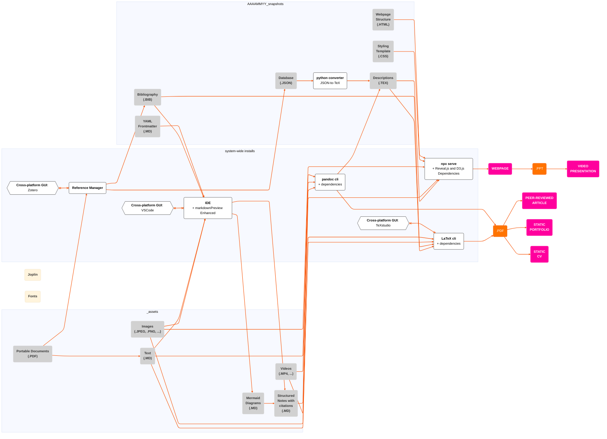

# Overview of Knowledge Management System

# How to Use
- Your markdown file and its additional resources should be located in a folder structure such as this: 
```
notes-folder/
├── _resources/
│   ├── IMG_6436.png
│   ├── IMG_6438.png
│   └── ...
├── input.md
```
- For example, let's take this as starting folder:
```
Appunti Corso Saldatura/
├── _resources/
│   ├── IMG_6436.png
│   ├── IMG_6438.png
│   └── ...
├── Appunti Corso Saldatura.md
```
- Run, from locally cloned repo:
```
NOTES="$HOME/Desktop/archival future"
ASSETS="/media/fede-ubuntu/STORAGE1/CW/_assets"
INPUT="archival future.md"
OUTPUT="archival future.pdf"

docker run --rm \
  -v "$NOTES:/data" \
  -v "$ASSETS:/_assets:ro" \
  -v "$ASSETS/fonts:/fonts:ro" \
  -w /data \
  --entrypoint /bin/sh \
  jakobkmar/pandoc-all-in-one \
  -c '
    cp /_assets/frontmatter.yaml .
    cp /_assets/latex-header.tex .

    pandoc "$1" \
      --from=markdown+lists_without_preceding_blankline+implicit_figures \
      --metadata-file=/_assets/frontmatter.yaml \
      --include-in-header=/_assets/latex-header.tex \
      --bibliography="bibliography.bib" \
      --citeproc \
      --pdf-engine=lualatex \
      -o "$2"
  ' sh "$INPUT" "$OUTPUT"
```
and link your `metadata.yaml`, `header.tex`, `bibliography.bib` to the correct location. In this way, the YAML frontmatter should control document-level settings, while the LaTeX header should handle custom typography and formatting that Pandoc's metadata cannot express directly.
- Keep updated with:
```
git add .
#stage your changes.
git commit -m "feat: ..."
#create a commit.
git push -u
```


